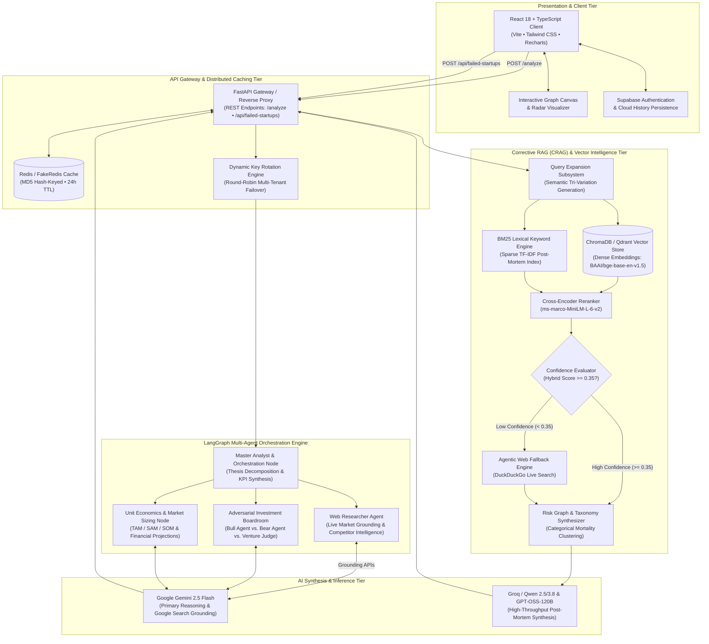
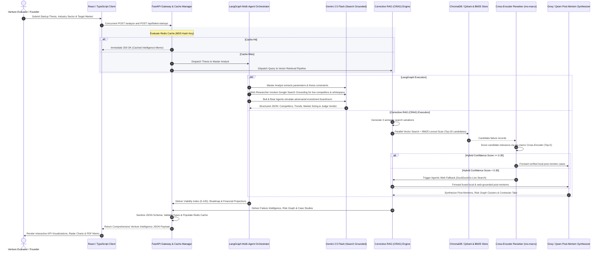

# StartupLens — Autonomous AI Co-Pilot for Market Validation

[](https://startup-lens-ten.vercel.app)
[](https://github.com/sumithshetty2005/StartupLens)

StartupLens is an autonomous venture intelligence and market validation co-pilot engineered to transform raw startup hypotheses into rigorous, data-grounded investment memos in seconds. By orchestrating multi-agent reasoning, real-time web grounding, and corrective retrieval over historical startup post-mortems, the platform enables founders and venture evaluators to de-risk capital allocation before building.

---

## Product Interface Showcase

<table width="100%">
  <tr>
    <td width="50%" align="center">
      
      <br />
      <em><b>Figure 1:</b> Interactive Landing Interface & 3D Autonomous Simulation Scene</em>
    </td>
    <td width="50%" align="center">
      
      <br />
      <em><b>Figure 2:</b> Startup Hypothesis Input, Sector Specification & Geographic Market Targeting</em>
    </td>
  </tr>
  <tr>
    <td width="50%" align="center">
      
      <br />
      <em><b>Figure 3:</b> Real-Time Multi-Agent Grounding, Crawling & Vector Store Retrieval Monitor</em>
    </td>
    <td width="50%" align="center">
      
      <br />
      <em><b>Figure 4:</b> Synthesized Viability Score, Whitespace Opportunity & TAM/SAM/SOM Sizing</em>
    </td>
  </tr>
</table>

---

## System Architecture

StartupLens deploys a decoupled, microservice-aligned architecture separating interactive presentation, gateway routing and caching, multi-agent reasoning, and corrective hybrid vector retrieval:



<details>
<summary><b>View Detailed Multi-Agent & Vector Retrieval Flow</b></summary>
<br/>



</details>

---

## Core Capabilities and Multi-Agent Architecture

StartupLens decomposes market validation into specialized agentic roles and retrieval subsystems, producing structured, auditable outputs:

| Agent / System Module | Core Responsibility | Structured Output |
| :--- | :--- | :--- |
| **Master Analyst & Orchestrator** | Deconstructs the business hypothesis, governs execution sequence, evaluates risk criteria, and synthesizes key metrics into a unified viability score. | Composite Viability Score (0–100), Strategic Roadmap (3-phase execution), Risk Analysis, and Executive Summary Memo. |
| **Web Researcher Agent** | Leverages Google Search grounding within the LLM context to evaluate real-time competitor density, active market shares, and emergent macroeconomic shifts. | Competitor Breakdown (Top 3 with Market Share %, Target Audience, Marketing Strategy), Whitespace Opportunity, and Market Dynamics. |
| **Corrective RAG (CRAG) Engine** | Performs multi-query hybrid retrieval over real-world startup failure post-mortems using dense vector indexing, BM25 lexical search, and cross-encoder reranking with automated web fallback. | Matched Post-Mortems (Startup Name, Sector, Cash Burned, Operational Lifespan, Root Cause of Failure, Key Takeaways). |
| **Risk Clustering & Graph Synthesizer** | Aggregates failure patterns into taxonomic risk clusters (Funding/Burn, Product-Market Fit, Execution, Saturation) and computes structural failure weightings. | Taxonomic Failure Distribution Percentages, Risk Graph Node Structure, and Categorical Mortality Insights. |
| **Adversarial Investment Boardroom** | Simulates an adversarial debate between a high-conviction Bull Agent and a skeptical Bear Agent, adjudicated by an impartial Venture Judge. | 3 Bull Conviction Drivers, 3 Bear Structural Vulnerabilities, and Final Judge Verdict (*Invest*, *Avoid*, or *Invest with Conditions*) with Confidence % (0–100). |
| **Unit Economics & Financial Projections** | Computes baseline unit economics, capital requirement thresholds, growth vectors, and break-even horizons modeled for the specific geographic market. | Revenue per User, Minimum Capital Expenditure Breakdown (Dev, Marketing, Ops), Break-Even Horizon (months), and Projected MoM Growth. |
| **Market Sizing & Demographic Profiler** | Calculates market size tiers for the target geographic territory and maps generational audience distribution cohorts. | TAM, SAM, SOM Financial Estimates with Confidence % and Calculation Rationale; Age Cohort Distribution (18–24, 25–34, 35–44, 45+). |
| **Contrarian Reality Synthesizer** | Audits mainstream consensus assumptions against empirical post-mortem evidence to uncover non-obvious operational landmines. | Contrarian Intelligence Pair: *Mainstream Consensus* vs. *Empirical Reality*. |
| **Resilience & Key Rotation Gateway** | Dispatches requests across multiple Gemini API keys to bypass rate limits, falls back to Groq / Qwen / GPT-OSS-120B on exhaustion, and caches analyses in Redis. | Zero-Downtime Multi-Key Round-Robin Routing, Automatic Secondary Model Failover, and Sub-Millisecond Cache Hits. |
| **Interactive Canvas & Export Engine** | Renders dynamic radar/bar/pie analytics and graph nodes with high-contrast presentation and client-side PDF memo export. | Interactive Visual Canvas, Live SVG/Canvas Visualizations, and Print-Optimized Executive Investment Memos. |

---

## Mathematical Formulation and Scoring Logic

### Composite Viability Score

The platform quantifies startup feasibility via a normalized composite index scored between $0$ and $100$. The score weights structural market barriers, unit dynamics, and timing factors:

$$
\text{Viability Score} = 0.20 \cdot \text{Market Density} + 0.15 \cdot \text{Entry Barrier} + 0.15 \cdot \text{Capital Intensity} + 0.20 \cdot \text{Timing and Trends} + 0.15 \cdot \text{Operational Complexity} + 0.15 \cdot \text{Scalability}
$$

*Each parameter is scored on a normalized scale ($0 \le S_i \le 100$) by the Master Analyst Agent based on grounded competitive density, regulatory overhead, and capital requirements.*

### Hybrid Retrieval Confidence Score

To ensure that historical post-mortems accurately represent the founder's space, the Corrective RAG (CRAG) pipeline evaluates candidate failure cases using a three-tier hybrid scoring formulation:

$$
\text{Score}_{\text{hybrid}} = 0.30 \cdot S_{\text{vector}} + 0.20 \cdot S_{\text{BM25}} + 0.50 \cdot S_{\text{cross-encoder}}
$$

Where:
- $S_{\text{vector}} \in [0, 1]$ represents normalized cosine similarity generated by `BAAI/bge-base-en-v1.5` embeddings.
- $S_{\text{BM25}} \in [0, 1]$ represents min-max normalized term frequency-inverse document frequency over post-mortem corpora.
- $S_{\text{cross-encoder}} \in [0, 1]$ represents the softmax logit output of the `ms-marco-MiniLM-L-6-v2` cross-encoder reranker.

If $\text{Score}_{\text{hybrid}} < 0.35$ (the configured `CONFIDENCE_THRESHOLD`), the retrieval engine tags the confidence as **Low** and activates the **Agentic Web Fallback** (`duckduckgo-search`), fusing live search signals with the local corpus before final LLM synthesis.

---

## Technology Stack

| Layer | Technology / Framework | Specification & Architectural Role |
| :--- | :--- | :--- |
| **Frontend & UI** | React 18, Vite, TypeScript | Component-driven Single Page Application (SPA) with strict type safety. |
| **Styling & Icons** | Tailwind CSS, Lucide React | High-contrast executive theme design with responsive layout systems. |
| **Data Visualization** | Recharts, Mermaid.js | Interactive pie, bar, radar charts, and dynamic topological architecture graphs. |
| **State & Authentication** | Supabase Auth, React Hooks | User session management, guest mode switching, and cloud analysis persistence. |
| **Backend & Routing** | FastAPI / Flask, Python 3.10 | REST API endpoints (`/analyze`, `/api/failed-startups`), CORS governance, JSON sanitization. |
| **Caching Layer** | Redis, FakeRedis | MD5-hashed query keying with 24-hour TTL caching for sub-millisecond memo retrieval. |
| **Agent Orchestration** | LangGraph, LangChain, Google GenAI SDK | Multi-agent coordination, prompt routing, and search grounding tool integration. |
| **Primary Reasoning LLM** | Google Gemini 2.5 Flash | Structured reasoning, parameter extraction, and real-time Google Search grounding. |
| **Secondary & Fallback LLMs** | Groq / Qwen 2.5/3.8, GPT-OSS-120B | High-throughput post-mortem synthesis, contrarian extraction, and quota failover. |
| **Vector Database** | ChromaDB, Qdrant | Dense vector storage and similarity search for startup post-mortem records. |
| **Dense Embeddings** | `BAAI/bge-base-en-v1.5` (HuggingFace) | 768-dimensional local dense embeddings optimized for semantic search. |
| **Reranking Engine** | `cross-encoder/ms-marco-MiniLM-L-6-v2` | Sentence-transformers cross-encoder for deep query-document relevance scoring. |
| **Lexical Search** | Custom BM25 | In-memory TF-IDF/BM25 engine for exact keyword and terminology matching. |
| **Containerization** | Docker, Dockerfile | Containerized multi-stage Python 3.10 production image. |
| **Cloud Hosting** | Hugging Face Spaces, Vercel | Containerized backend hosting (port 7860) and edge-deployed frontend SPA. |

---

## Project Structure

<details>
<summary><b>View Repository Directory Layout</b></summary>
<br/>

```
StartupLens/
├── data/                                 # Datasets & vector storage
│   ├── CSV/                              # Raw sector post-mortems (Healthcare, Retail, Finance, etc.)
│   ├── qdrant/                           # Local Qdrant vector collection and lock files
│   └── startup_knowledge_base.json       # Structured knowledge base records
├── docs/                                 # Documentation & media assets
│   ├── images/                           # System and workflow diagrams
│   └── screenshots/                      # UI interface capture assets (.gitkeep)
├── frontend/                             # React SPA client application
│   ├── public/                           # Static favicon, logos, and icons
│   ├── src/                              # TypeScript application logic
│   │   ├── assets/                       # UI SVG assets
│   │   ├── components/                   # Dashboard, LandingPage, Canvas, MermaidChart, ThreeScene
│   │   ├── lib/                          # Supabase client and auth configurations
│   │   ├── App.tsx                       # Root view state and session router
│   │   └── main.tsx                      # Vite React entrypoint
│   ├── package.json                      # Node dependencies and scripts
│   ├── tailwind.config.js                # Custom palette and typography configuration
│   └── vite.config.ts                    # Vite build configuration
├── src/                                  # Backend Python application
│   ├── agents/                           # Multi-agent orchestrator modules
│   │   ├── agent.py                      # Gemini Native client, search grounding, prompt graphs
│   │   └── __init__.py
│   ├── rag/                              # Corrective RAG pipeline components
│   │   ├── config.py                     # Model configurations, weights, and thresholds
│   │   ├── embeddings.py                 # Dense vector embedding model loader
│   │   ├── enrichment.py                 # Grounded context enrichment functions
│   │   ├── ingestion.py                  # CSV/JSON preprocessing and vector collection builder
│   │   ├── reranker.py                   # Local Cross-Encoder reranking pipeline
│   │   ├── retriever.py                  # Hybrid search (Dense + BM25 + Cross-Encoder) & CRAG logic
│   │   └── __init__.py
│   ├── main.py                           # CLI analysis runner and terminal interface
│   ├── server.py                         # FastAPI/Flask production gateway, Redis cache, key rotators
│   └── __init__.py
├── .env.example                          # Environment configuration template
├── API_DOCS.md                           # Interactive Swagger & API contract specification
├── Dockerfile                            # Production container build specification
├── requirements.txt                      # Python backend dependencies
└── README.md                             # Project specification and engineering manual
```

</details>

---

## Local Installation and Setup

### Prerequisites
- **Node.js**: `v18.0.0` or higher
- **Python**: `v3.10` or higher
- **Google Gemini API Key(s)**: At least one active key (supports comma-delimited rotation)
- **Groq API Key**: (Optional, recommended) For failure analysis RAG speedups and secondary failover

### Environment Configuration
Clone the repository and initialize your local environment configuration:

```bash
git clone https://github.com/sumithshetty2005/StartupLens.git
cd StartupLens
cp .env.example .env
```

Configure `.env` with your API credentials:

```env
# Separate multiple Gemini keys with commas for automated rotation
GOOGLE_API_KEYS=AIzaSyYourFirstKey...,AIzaSyYourSecondKey...
GOOGLE_API_KEY=AIzaSyYourFirstKey...
GROQ_API_KEY=gsk_your_groq_api_key_here
PORT=8000
```

### Vector Database Ingestion
Initialize the local vector database with historical startup post-mortem records:

```bash
# Create and activate Python virtual environment
python -m venv venv
source venv/bin/activate  # On Windows: venv\Scripts\activate

# Install backend dependencies
pip install -r requirements.txt

# Ingest startup failure corpora into Qdrant/ChromaDB
python -m src.rag.ingestion
```

### Backend Service Startup
Launch the API gateway:

```bash
python src/server.py
```
*The interactive API documentation is accessible at `http://localhost:8000/docs` (or root health check at `http://localhost:8000/`).*

### Frontend Development Server
In a separate terminal session, initialize and start the React client:

```bash
cd frontend
npm install
npm run dev
```
*The client application launches at `http://localhost:5173`.*

### Docker Deployment
Build and run the containerized backend locally:

```bash
docker build -t startuplens-backend .
docker run -p 7860:7860 --env-file .env startuplens-backend
```

---

## Deployment and Troubleshooting

<details>
<summary><b>View Deployment & Troubleshooting Runbook</b></summary>
<br/>

### Production Deployment

#### Hugging Face Spaces (Backend Container)
1. Initialize a new Docker Space on Hugging Face configured for port `7860`.
2. Connect the GitHub repository or push directly to the HF Space remote repository.
3. Configure Repository Secrets:
   - `GOOGLE_API_KEYS`: Comma-delimited list of Google Gemini API keys.
   - `GROQ_API_KEY`: Groq Cloud API key for fast failure synthesis and fallback.
   - `PORT`: Set to `7860`.
4. Hugging Face automatically executes `Dockerfile`, installs dependencies, pre-stages the Python environment, and exposes the REST API on port `7860`.

#### Vercel Edge Deployment (Frontend Client)
1. Import the `frontend/` directory into Vercel.
2. Set Framework Preset to **Vite**.
3. Configure Environment Variables:
   - `VITE_API_BASE_URL`: URL of the deployed backend container (e.g., `https://<hf-space-id>.hf.space`).
   - `VITE_SUPABASE_URL`: (Optional) Supabase project URL for authentication.
   - `VITE_SUPABASE_ANON_KEY`: (Optional) Supabase anonymous public key.
4. Deploy the production edge build (`npm run build`).

### Operational Troubleshooting

| Issue / Symptom | Root Cause | Resolution Protocol |
| :--- | :--- | :--- |
| `API_QUOTA_EXHAUSTED` (HTTP 429) | Primary Gemini API key exhausted daily request or token quota. | Add multiple Gemini keys separated by commas in `GOOGLE_API_KEYS`. The system automatically shifts to the next key. Ensure `GROQ_API_KEY` is defined for secondary model failover. |
| `Qdrant Local Lock Error` | Previous process retained the directory lock on `data/qdrant/.lock`. | Terminate orphan Python processes or manually remove the lockfile: `rm data/qdrant/.lock`. The retriever includes defensive `finally` lock release logic. |
| Cold-Start Timeout on Initial Request | Cloud container spun down on free-tier hosting. | Allow 30–50 seconds for the container to reload model weights (`bge-base-en-v1.5` and `ms-marco-MiniLM-L-6-v2`) into memory. All subsequent requests respond immediately. |
| Missing `GROQ_API_KEY` in RAG endpoint | `/api/failed-startups` requires Groq for fast failure summarization. | Verify `GROQ_API_KEY` is present in `.env` or input a temporary key via the frontend Key Override modal in the Dashboard. |
| CORS Header Block | Frontend origin rejected by backend. | `server.py` enables `CORS(app, resources={r"/*": {"origins": "*"}})`. Ensure API requests hit the exact backend domain and protocol (`https://`). |

</details>

---

## Project Links

- **Demo Video Link:** [Video Presentation](https://drive.google.com/drive/u/0/folders/1Fiobl0-W6ajw6asrBZznjJ7qF0629BAj)
- **Live Deployed Application:** [https://startup-lens-ten.vercel.app](https://startup-lens-ten.vercel.app)
